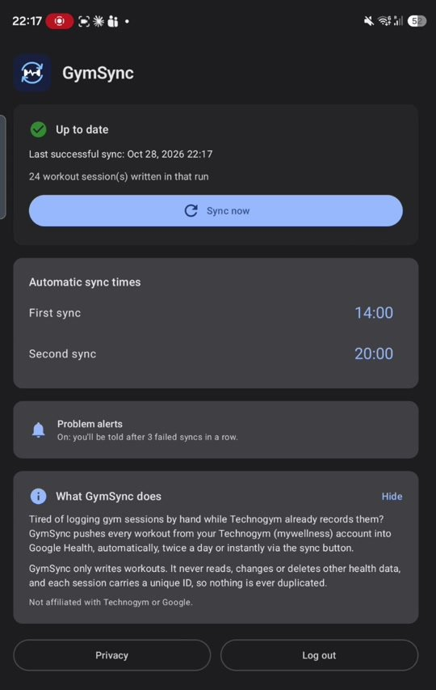

# GymSync

Your gym's Technogym machines record every workout in your Technogym (mywellness) account, but Google Health never sees them.
GymSync syncs them: twice a day it fetches your finished sessions and writes them into **Health Connect**, where Google Health picks them up.



- Every finished gym session is written as one or two workouts (cardio and/or strength) with the machines' exact duration, calories and distance.
- Write-only: never reads, changes or deletes other Health Connect data. Stable record IDs, so re-syncing never duplicates.
- No server, no analytics. Credentials are stored on the phone, encrypted (Tink, key in Android Keystore).
- Two configurable sync times per day plus "Sync now". Optional notification after three failed syncs.

## Disclaimer

Unofficial, hobby software. Not affiliated with, endorsed by or supported by Technogym or Google. It talks to the undocumented
mywellness web API with your own credentials; that may conflict with Technogym's terms of use, and it can stop working whenever
they change something. You run it on your own account, at your own risk. No warranty of any kind (see `LICENSE`).
Technogym, mywellness, Google Health and Health Connect are trademarks of their respective owners.

## Install

Requirements: Android 14+, Health Connect, a mywellness account with your gym linked.

Build from source (Android Studio with SDK 37, or the command line):

```bash
./gradlew testDebugUnitTest          # 34 unit tests
./gradlew installDebug               # installs on a connected phone
```

Then in the app: log in → allow Health Connect → allow background sync. Set the app's battery usage to *Unrestricted* so the scheduled syncs run on time.

## How it works

```
mywellness API ──login──> session list (last 7 days, 30 on first run)
                └──> per session: GetPerformedWorkoutSessionByIdCr
                       └──> Mapper (pure Kotlin): cardio block + strength block
                              └──> Health Connect insertRecords (upsert by clientRecordId)
```

| File | Role |
|---|---|
| `api/MywellnessApi.kt` | OkHttp + kotlinx.serialization client; checks `errors[]`, re-logs in on token expiry |
| `sync/Mapper.kt` | API models → planned Health Connect records; fails closed on anything unexpected |
| `sync/SyncEngine.kt` | fetch → map → write, ≤1 request/s, per-session error isolation |
| `sync/HcWriter.kt` | `ExerciseSessionRecord`, `ActiveCaloriesBurnedRecord`, `DistanceRecord` |
| `sync/Scheduler.kt` / `SyncWorker.kt` | WorkManager: two daily slots, "sync now", one retry |
| `data/Store.kt` | DataStore + Tink for credentials and status |
| `API_NOTES.md` | The verified API: endpoints, bodies, response shapes, timeline semantics |

Fixtures under `app/src/test/resources/fixtures/` are real responses with personal and club data redacted.

## Status

Tested on one Android 16 phone and one gym. Other clubs/machines may expose different `equipmentName` values;
see the mapping table in `Mapper.kt` and extend it. PRs welcome.

## Licence

MIT, see `LICENSE`. No binaries are distributed; build it yourself.
